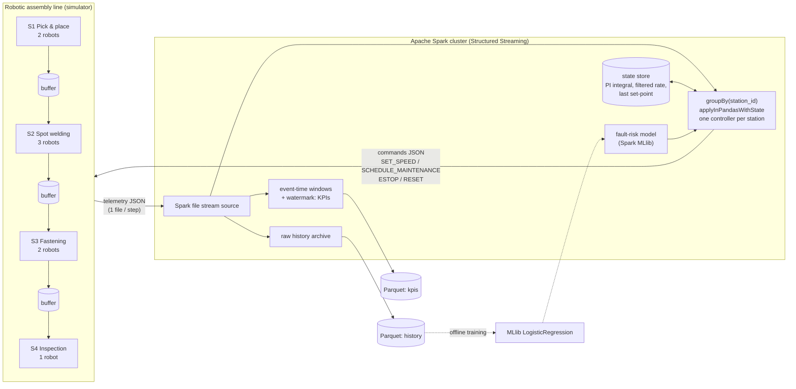

# Architecture

## Control loop

## Why this is distributed

| Concern | How Spark distributes it |
|---|---|
| Real-time control | The telemetry stream is grouped by `station_id`. Each station is a key and is handled by its own task, so the four station controllers run in parallel on different executors and scale out with more stations or lines. |
| Controller memory | Each station's PI integral, filtered output rate and last set-point live in Spark's state store, which is checkpointed. A restarted job continues where it stopped. |
| Monitoring | KPIs use event-time windows with a watermark, so late or out-of-order telemetry is handled correctly. |
| Learning | The fault-risk model is trained with Spark MLlib on the archived history (scaler + logistic regression), then exported as plain coefficients that the streaming controller scores with numpy. |
| Evaluation | The policy benchmark runs every (policy, seed) simulation as a separate Spark task. |

## Control law (per station, per micro-batch)

1. **Health scoring:** fault risk `p = sigmoid(b + Σ wᵢ (xᵢ − μᵢ)/σᵢ)` from temperature, vibration, torque, position error and speed.
2. **Safety interlock:** if any hard limit is exceeded the robot gets `ESTOP`. It gets `RESET` once it has cooled down, or `SCHEDULE_MAINTENANCE` if its risk is high.
3. **Predictive maintenance:** risk ≥ 0.80 schedules maintenance, at most one robot per station at a time unless risk ≥ 0.95. Risk ≥ 0.50 caps the robot's speed at 0.85.
4. **Throughput balancing:**
   - Feed-forward: `speed_ff = takt_rate × nominal_cycle / producing_robots × margin`
   - PI correction on the filtered station output rate: `speed = speed_ff × (1 + kp·e + ki·∫e)`, where `e = (target − rate)/target`
   - Anti-windup: the integral is frozen when the station is **blocked** (downstream bottleneck, so it backs off) or **starved** (upstream bottleneck, so it doesn't speed up)
   - Set-point changes are rate-limited (±0.08 per batch) and clamped to [0.6, 1.25]

## Data contracts

**Telemetry** (one row per robot per step): `ts, step, line_id, station_id, robot_id, state, speed_factor, cycle_completed, cycles_done, last_cycle_time_s, joint_temp_c, vibration_mm_s, torque_nm, position_error_mm, buffer_in, buffer_out, buffer_out_capacity, line_finished_units`

**Command** (one row per robot per micro-batch): `line_id, station_id, robot_id, issued_for_step, issued_at, action, speed_setpoint, risk_score, reason, robot_state, station_rate_uph, target_uph, frac_blocked, frac_starved`

The line applies a command only if its `issued_for_step` is newer than the last command that robot applied. It also ignores maintenance orders raised before the robot's last service, so late or duplicated commands are harmless.

## Simulator physics (summary)

- Cycle time = nominal / speed × lognormal noise, and the noise grows with wear.
- Wear grows with speed³, and each robot has its own wear rate. Maintenance resets wear to 0.05 (3 minutes of downtime); a fault resets it to 0.10 (10 minutes of downtime).
- Temperature, vibration, torque and position error all rise with speed and wear.
- Fault hazard per step: `0.0002 + 0.35 · max(0, wear − 0.55)²`, plus 0.03 when the joint is hotter than 90 °C.
